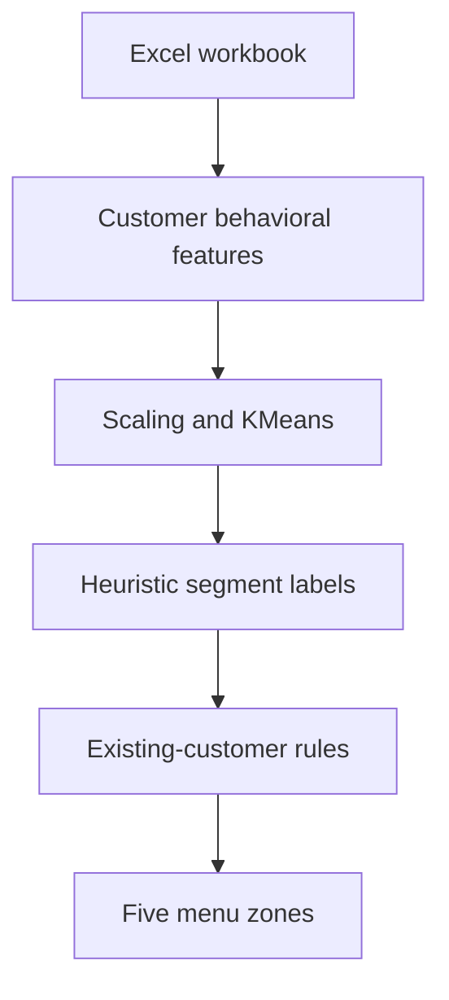
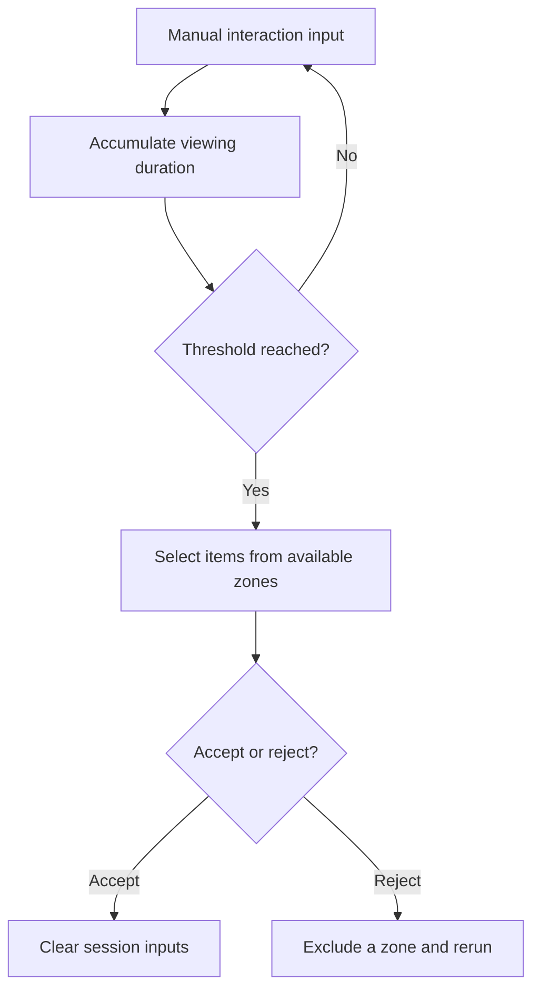

# Menu Recommendation Flow

Retrospective documentation of `streamlit_app3.py`; not an original research artifact or Draw.io export.

A separate `recommend_knn()` helper exists in the code but is not connected to these active UI paths. The diagrams intentionally distinguish implemented interface behavior from available experimental functions.
